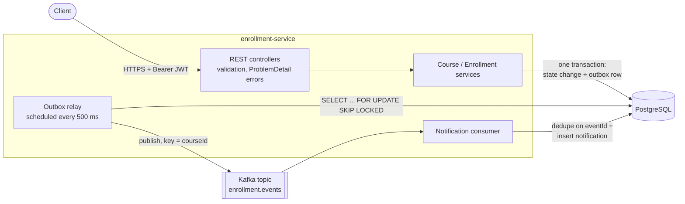
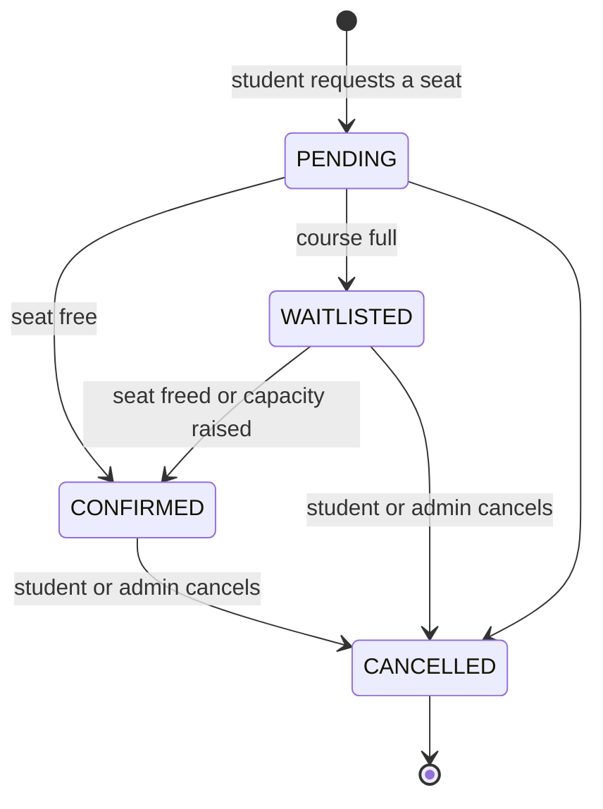

# enrollment-service-spring

[](https://github.com/hareshnarola101/enrollment-service-spring/actions/workflows/ci.yml)

A course-enrollment microservice for an online learning platform, built with Java 21 and Spring Boot 3.5.

I built this to show how I handle the parts of a backend service that tend to go wrong in production: two people grabbing the last seat at the same moment, a database commit that succeeds while the event publish fails, and a consumer that receives the same message twice. The domain is small on purpose so those parts stay easy to see.

## What it does

- **Courses** have a fixed number of seats. Admins create and edit them.
- **Students** register, log in and enroll. If a seat is free the enrollment is `CONFIRMED`; if the course is full the student goes on a `WAITLISTED` queue.
- **Cancelling** a confirmed enrollment frees the seat, and the first student on the waitlist is promoted in the same transaction. Raising a course's capacity promotes waitlisted students the same way.
- **Events** (`EnrollmentConfirmed`, `EnrollmentCancelled`, `StudentPromotedFromWaitlist`) go to Kafka through a transactional outbox.
- A **notification consumer** in the same app reads those events and writes a notification log, handling duplicate deliveries safely.

Stack: Java 21, Spring Boot 3.5, Spring Security 6 (stateless JWT), Spring Data JPA / Hibernate, PostgreSQL 16, Flyway, Spring Kafka, springdoc-openapi, JUnit 5, Mockito, Testcontainers.

## Architecture



The code is organised by feature rather than by layer:

```
com.hareshnarola.enrollment
├── auth          login/registration, JWT issuing, security config, admin bootstrap
├── course        Course entity, admin CRUD, row-lock repository method
├── enrollment    Enrollment entity + state machine, enroll/cancel, waitlist promotion, event publishing
├── outbox        outbox table, writer (MANDATORY transaction), relay to Kafka
├── notification  Kafka consumer, idempotency store, notification log
└── common        ProblemDetail error handling, pagination DTO, OpenAPI and clock config
```

## Enrollment state machine



The allowed transitions live in `EnrollmentStatus.canTransitionTo`, and `Enrollment` refuses anything else with a 409. `PENDING` is the state of a request before the seat decision. Today that decision happens in the same transaction, so `PENDING` is never committed, but it gives a payment or approval step somewhere to go without changing the model. A cancelled enrollment is history: the student can enroll again, which creates a new row.

## Quickstart

You need Docker. Nothing else has to be installed.

```bash
docker compose up --build
```

This starts PostgreSQL, Kafka (single node, KRaft mode, no ZooKeeper) and the service on port 8080. Flyway creates the schema on startup, and a dev admin account is created from environment variables in `docker-compose.yml`:

| | |
|---|---|
| Admin login | `admin@example.com` / `admin-password` (dev only) |
| Swagger UI | http://localhost:8080/swagger-ui.html |
| OpenAPI JSON | http://localhost:8080/v3/api-docs |
| Health | http://localhost:8080/actuator/health (plus `/liveness` and `/readiness`) |

If ports 5432, 9092 or 8080 are already taken on your machine, override them: `POSTGRES_PORT=5434 KAFKA_PORT=9094 APP_PORT=8081 docker compose up --build`.

All credentials in the compose file are for local use. In any shared environment, set `JWT_SECRET` (at least 32 random bytes), the database credentials, and either remove the bootstrap admin variables or use a real password.

## API examples

These use `jq` to pull values out of responses.

**Log in as admin and create a course with two seats**

```bash
ADMIN=$(curl -s localhost:8080/api/auth/login \
  -H 'Content-Type: application/json' \
  -d '{"email":"admin@example.com","password":"admin-password"}' | jq -r .accessToken)

COURSE=$(curl -s localhost:8080/api/courses \
  -H "Authorization: Bearer $ADMIN" -H 'Content-Type: application/json' \
  -d '{"code":"JAVA-301","title":"Concurrency in Java","capacity":2}' | jq -r .id)
```

**Register a student and log in**

```bash
curl -s localhost:8080/api/auth/register -H 'Content-Type: application/json' \
  -d '{"email":"asha@example.com","password":"asha-password","fullName":"Asha Patel"}'

ASHA=$(curl -s localhost:8080/api/auth/login -H 'Content-Type: application/json' \
  -d '{"email":"asha@example.com","password":"asha-password"}' | jq -r .accessToken)
```

**Enroll**

```bash
curl -s -X POST localhost:8080/api/courses/$COURSE/enrollments -H "Authorization: Bearer $ASHA"
```

```json
{"id":1,"courseId":1,"studentId":2,"status":"CONFIRMED","createdAt":"...","updatedAt":"..."}
```

When the course is full, enrolling returns `"status":"WAITLISTED"` instead.

**Errors** all use RFC 7807 problem details. Enrolling a second time, for example:

```bash
curl -s -X POST localhost:8080/api/courses/$COURSE/enrollments -H "Authorization: Bearer $ASHA"
```

```json
{
  "type": "about:blank",
  "title": "Request conflicts with current state",
  "status": 409,
  "detail": "You are already enrolled or waitlisted for this course",
  "instance": "/api/courses/1/enrollments"
}
```

**Cancel**

```bash
curl -s -X POST localhost:8080/api/enrollments/1/cancel -H "Authorization: Bearer $ASHA"
```

If a student was waiting, their enrollment is now `CONFIRMED`. A moment later each affected student can see the notification the Kafka consumer wrote:

```bash
curl -s localhost:8080/api/notifications/me -H "Authorization: Bearer $ASHA" | jq
```

### Endpoints

| Method | Path | Who |
|---|---|---|
| POST | `/api/auth/register` | anyone (creates a STUDENT) |
| POST | `/api/auth/login` | anyone |
| GET | `/api/courses?page=0&size=20&sort=id,asc` | authenticated |
| GET | `/api/courses/{id}` | authenticated |
| POST | `/api/courses` | ADMIN |
| PUT | `/api/courses/{id}` | ADMIN |
| POST | `/api/courses/{id}/enrollments` | STUDENT |
| GET | `/api/courses/{id}/enrollments?status=WAITLISTED` | ADMIN |
| GET | `/api/enrollments/me` | authenticated |
| GET | `/api/enrollments/{id}` | owner or ADMIN |
| POST | `/api/enrollments/{id}/cancel` | owner or ADMIN |
| GET | `/api/notifications/me` | authenticated |

## Why a transactional outbox

The simple version of "save, then publish" has two failure modes. If the service commits to PostgreSQL and then crashes or Kafka is down, the event is lost and downstream systems never hear about the enrollment. If it publishes first and the commit then fails, downstream systems hear about an enrollment that does not exist. Wrapping both in one distributed transaction is not a realistic option with Kafka and PostgreSQL.

So the service never talks to Kafka during a request. `EnrollmentService` writes the event into an `outbox_events` table in the **same transaction** as the enrollment change: either both are committed or neither is. `OutboxWriter` uses `Propagation.MANDATORY`, so calling it outside a transaction fails loudly instead of quietly breaking that guarantee.

`OutboxRelay` then runs on a schedule:

1. Claims up to 100 unpublished rows with `SELECT ... FOR UPDATE SKIP LOCKED`, ordered by id. `SKIP LOCKED` means several instances of the service can run the relay at once without sending the same row twice or waiting on each other.
2. Sends each row to Kafka and waits for the acknowledgement (`acks=all`, idempotent producer).
3. Marks the row published. If a send fails, it stops right there, so a later event never overtakes an earlier one, and the rest are retried on the next run.

This gives **at-least-once** delivery: if the service dies after Kafka acknowledged a message but before the "published" mark is committed, that message goes out again. The consumer handles that. `NotificationService` inserts `(consumer, eventId)` into `processed_events` with `ON CONFLICT DO NOTHING` in the same transaction as the notification. If the insert affects no rows, the event was already handled and is skipped. Because it is one atomic statement, two copies of an event processed at the same moment cannot both get through.

Messages are keyed by course id, so all events for a course land on the same partition and are consumed in the order they happened (confirmed → cancelled → promoted).

## Concurrency approach

The core invariant is: **confirmed enrollments for a course never exceed its capacity**, and each student has at most one live enrollment per course.

I used a **pessimistic row lock** on the course (`SELECT ... FOR UPDATE`, via `@Lock(PESSIMISTIC_WRITE)` in `CourseRepository.findByIdForUpdate`). Every operation that changes seats or the waitlist (enroll, cancel, capacity change) takes this lock first. That serialises work per course while different courses run fully in parallel.

Why not optimistic locking with `@Version`? Seat allocation is a hot-spot workload: when a popular course opens, many students hit the same row at once. With optimistic locking, all but one of them fail with a version conflict and must retry, then most of those fail again, and so on. That means retry loops in the service or errors pushed to clients, exactly when load is highest. A row lock makes them queue instead, and each transaction is short (a few indexed queries). Optimistic locking fits better when conflicts are rare, like two admins editing a course description, which this service does not need yet.

Details that make the lock reliable:

- **Lock first, then read.** `cancel` looks up only the course id of the enrollment (a scalar query that does not load the entity), takes the course lock, and only then loads the enrollment. Reading the enrollment before the lock could act on a status another transaction is about to change. There is a unit test that checks this order.
- **One lock order everywhere.** Course first, then its enrollments. Two transactions can never hold locks the other is waiting for, so there are no deadlocks.
- **The counter lives on the locked row.** `courses.seats_taken` is updated under the lock, so the capacity check is a field comparison, not a `COUNT(*)` that could race.
- **The database still checks.** `CHECK (seats_taken <= capacity)` and a partial unique index on `(course_id, student_id) WHERE status IN ('PENDING','CONFIRMED','WAITLISTED')` reject overbooking or duplicates even if a future code path forgets the lock. A violation maps to 409.

`ConcurrentEnrollmentIT` checks this against real PostgreSQL: 20 students enroll in a 5-seat course at the same instant (exactly 5 confirmed, 15 waitlisted); one student sends 8 parallel enroll requests (exactly one 201, seven 409s); and three simultaneous cancellations each hand their seat to a different waitlisted student.

## Running the tests

```bash
./mvnw verify
```

`verify` runs both suites:

- **Unit tests** (`*Test`, Surefire, about 1 second): domain rules (`Course`, the `Enrollment` state machine), services with Mockito (waitlist promotion, capacity rules, lock-before-read order, ownership checks), the outbox relay's stop-on-failure behaviour, consumer deduplication, and JWT issue/verify/expiry.
- **Integration tests** (`*IT`, Failsafe): the whole application over HTTP, with PostgreSQL and Kafka started by Testcontainers. They cover the REST API, validation and ProblemDetail responses, 401/403 handling, pagination, concurrent enrollment, the full outbox → Kafka → consumer flow, duplicate delivery and a poison-pill message.

Integration tests need a running Docker daemon. All integration tests share one Spring context, so the containers start once per run.

If you do not have Java installed locally, you can run the build inside a container. On Docker Desktop:

```bash
docker run --rm -v "$PWD":/app -w /app -v "$HOME/.m2":/root/.m2 \
  -v /var/run/docker.sock:/var/run/docker.sock \
  -e TESTCONTAINERS_HOST_OVERRIDE=host.docker.internal \
  maven:3.9-eclipse-temurin-21 mvn -B verify
```

CI runs `./mvnw -B verify` on `ubuntu-latest`, then builds the Docker image.

## Design decisions and trade-offs

- **Spring Security's resource server instead of a custom JWT filter.** The service issues HS256 tokens with `NimbusJwtEncoder` and validates them with the standard `oauth2ResourceServer().jwt()` support. That is less code to get wrong, and moving to an external identity provider later only means replacing the `JwtDecoder` bean. A shared secret is fine for a single service; with several services I would switch to RS256 and publish a JWKS.
- **Login does the same work whether or not the email exists.** For unknown emails it still runs a BCrypt check against a dummy hash, so response time does not reveal which emails are registered.
- **Aggregates reference each other by id.** `Enrollment` holds `courseId` and `studentId`, not JPA associations. Nothing needs to navigate across, and it avoids lazy-loading surprises and accidental cascades.
- **Rich entities, thin services.** `Course.takeSeat`, `Course.changeCapacity` and `Enrollment.confirm/waitlist/cancel` hold the rules; services orchestrate locking, persistence and events. That is why most rules can be unit tested without Spring.
- **Capacity increases use a Spring application event** (`CourseCapacityIncreased`), handled synchronously in the same transaction by `WaitlistPromoter`. This keeps the `course` package from depending on `enrollment`.
- **The relay holds a database transaction while waiting on Kafka.** That keeps the code simple and the ordering guarantee obvious. I bounded the cost with a batch limit and short producer timeouts (`max.block.ms`, `delivery.timeout.ms`), so an outage costs a few seconds per run, not a minute.
- **One topic with an `eventType` header** instead of a topic per event type. Consumers that care about ordering across event types for a course get it for free.
- **No waitlist position in responses.** It is a cheap count query, but it changes every time someone ahead cancels, so I left it out of the first version rather than return a number that is already out of date.
- **The consumer lives in the same app** only to keep the demo self-contained. It reads its own message type rather than reusing the producer's class, so it could move to a separate service without changes.

## What I'd add next

- A **dead-letter topic** for consumer messages that exhaust their retries, instead of logging and skipping them.
- **Cleanup of old outbox and processed-event rows** (for example, delete published rows after 7 days), or table partitioning by month.
- **Metrics and tracing**: Micrometer counters for enrollments and promotions, a gauge for outbox lag (oldest unpublished row), and trace context propagated through Kafka headers.
- **Refresh tokens and logout**, or delegating authentication to an identity provider (Keycloak, Auth0) and keeping this service as a pure resource server.
- **Waitlist position and enrollment deadlines** on courses.
- **Change data capture with Debezium** as an alternative to the polling relay once write volume makes polling wasteful.
- **Rate limiting** on login and enroll endpoints.

## License

MIT, see [LICENSE](LICENSE).
